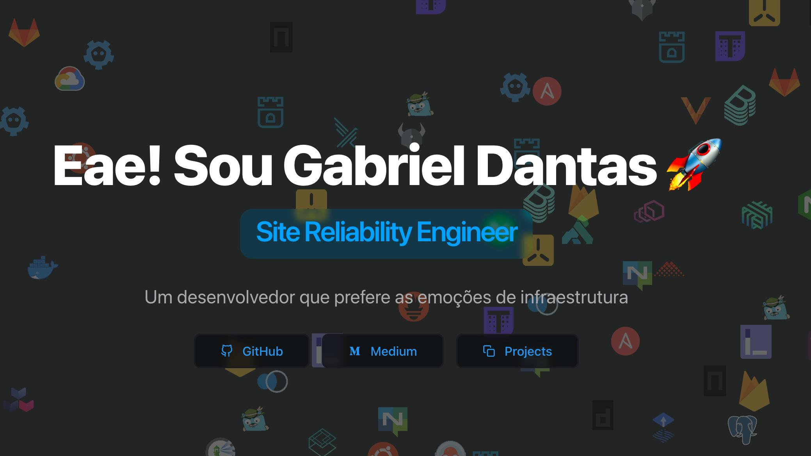

<div align="center">

<a target="_blank" href="https://gdantas.com.br">
    
</a>

[](https://gdantas.com.br)
[](https://github.com/tdemapp/website/blob/master/LICENSE)

</div>

## 🛠 Development

Clone the repository

```zsh
git clone https://github.com/gabriel-dantas98/gdantas.io.git
```

Install dependencies

```zsh
npm install

# Or using Yarn

yarn
```

Start the development server

```zsh
npm run dev

# Or using Yarn

yarn dev
```

Build for production

```zsh
npm run build

# Or using Yarn

yarn build
```

## WebMCP local smoke test

With the project dependencies installed, run the harness with a Chromium build that
supports WebMCP and its DevTools Protocol domain:

```bash
WEBMCP_CHROMIUM_PATH=/usr/bin/chromium node scripts/webmcp-smoke.mjs
```

Set `WEBMCP_CHROMIUM_PATH` to your browser executable. Omit it to use Playwright's
installed Chromium. The harness serves a fixture on a random loopback port,
registers an echo tool, discovers and invokes it through Chromium, and checks the
response. It runs independently of the Next.js server and external services.

To verify the site's read-only `list_talks` tool in both languages, start
`yarn dev` in another terminal and pass the local site URL:

```bash
WEBMCP_CHROMIUM_PATH=/usr/bin/chromium WEBMCP_SITE_URL=http://127.0.0.1:3000/ \
  node scripts/webmcp-smoke.mjs
```

The tool accepts an optional `locale` of `pt` or `en`. It defaults to the
current page language and returns the public talk catalog with canonical links.

## 📄 License

MIT © [Ben Dixon](https://github.com/gabriel-dantas98/gdantas.io/blob/main/LICENSE)

## Credits

This project is inspired by [nuro.dev](https://github.com/NuroDev/nuro.dev)

## Presentations / talks

Canonical recipe: `.agents/skills/adding-a-talk/SKILL.md` (Cursor command: `.cursor/commands/add-presentation.md`).

Add the talk to `data/presentations.json` **and** `talks.items.<slug>` in both `locales/pt.json` and `locales/en.json`, then run `yarn talks:og`. Individual pages (`/talks/<slug>`, `/en/talks/<slug>`), home cards, `/talks`, `/presentations`, sitemap and OG images all derive from that slug.

Each `presentations.json` item supports:

-   `slug` (required, kebab-case)
-   `event` (required)
-   `title` / `description` (fallback; locales win at render)
-   `icon` (iconify id) / `color` (hex)
-   `contentUrl` (canonical content link; `url` is legacy)
-   `githubUrl` (optional companion repo)
-   `date` (`YYYY-MM-DD`) / `location`
-   `preview` (optional object):
    -   Google Slides — **must** set `slidesEmbedUrl` (`.../embed?start=false&loop=false&delayms=3000`)
    -   YouTube: `{ "type": "youtube", "youtubeId": "..." }`
    -   Canva / Spotify / PDF as in existing entries

Then: `yarn i18n:check && yarn talks:check && yarn type-check && yarn build`.
